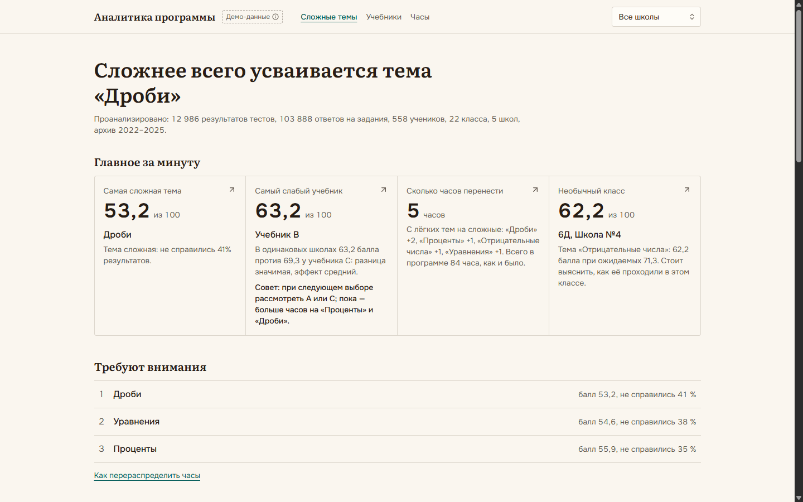
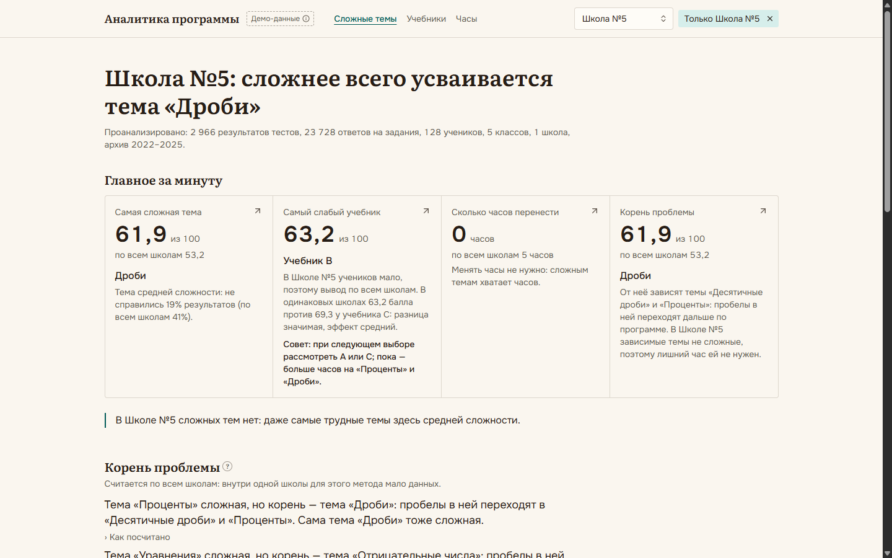
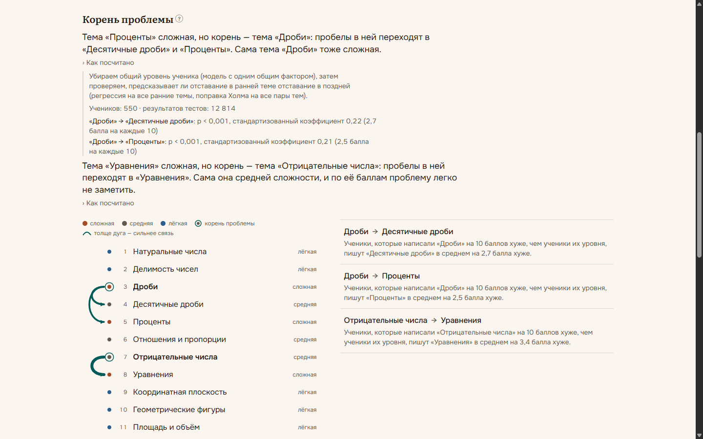
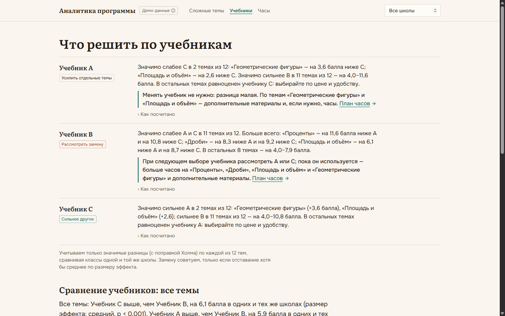
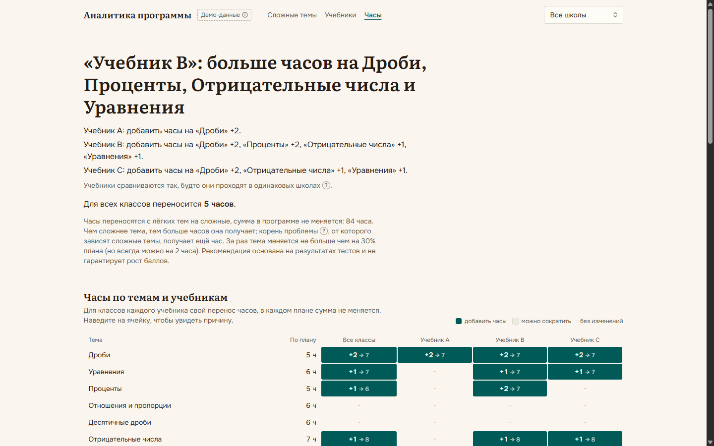
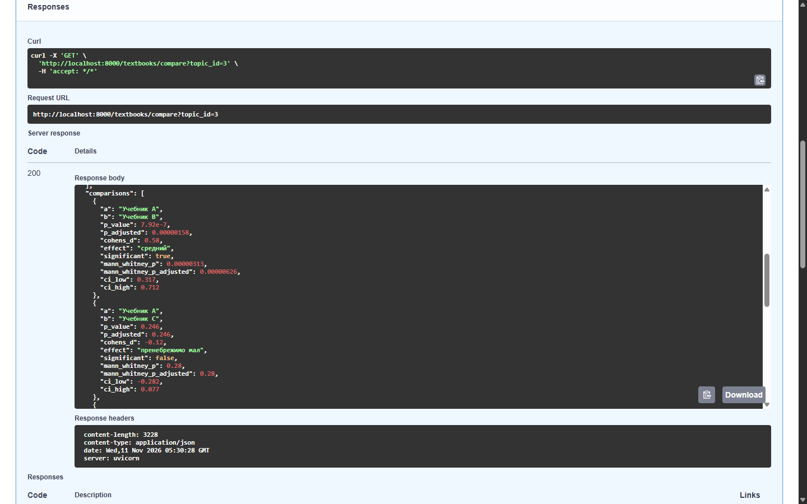

# Data-Driven Curriculum

Интеллектуальная система оценки эффективности учебников и учебных программ для методистов.

## Проблема и решение

Учебники и часы на темы сейчас выбирают по ощущениям и по простым средним баллам. Простое среднее обманывает:
учебник, который чаще выбирают сильные школы, выглядит лучшим, даже если учит не лучше других. Система берёт
результаты тестов школьников по темам и на Python считает, какие темы усваиваются хуже, какой учебник реально
слабее в одних и тех же школах, какая ранняя тема тянет за собой провал следующих и как перераспределить часы.
Каждый вывод написан понятным языком, а под ним раскрывается «Как посчитано»: метод, объём данных, p-value
и размер эффекта.

## Скриншоты

| | |
|---|---|
|  |  |
| Главная: вывод, объём данных и «Главное за минуту» | Та же главная с фильтром «Школа №5»: цифры школы и рядом по всем школам |
|  |  |
| «Корень проблемы»: связи тем и «Как посчитано» | «Учебники»: блок «Что решить по учебникам» |
|  |  |
| «Часы»: перенос часов по темам и учебникам | http://localhost:8000/docs: ответ `/textbooks/compare?topic_id=3` с p-value |

## Что умеет система

- **Главная.** Самая сложная тема, строка «Проанализировано: …» и четыре карточки «Главное за минуту»: самая
  сложная тема, самый слабый учебник с советом, сколько часов перенести, необычный класс или корень проблемы.
  Ниже — «Требуют внимания», «Корень проблемы» с дуговой диаграммой связей тем, тепловая карта «тема × школа»,
  темы, которые меняются по годам, и необычные результаты классов.
- **Фильтр по школе** в шапке (`?school=5` в адресе, сохраняется при переходах). С ним всё пересчитывается
  по школе, тепловая карта становится «тема × класс», а рядом с цифрами — значения по всем школам. Где внутри
  одной школы данных мало (учебник, у которого меньше 30 учеников), система не делает вывода и пишет об этом.
- **Страница темы.** Балл, доля несдавших, индекс сложности, что делать с часами, связи с другими темами,
  тренд, распределение баллов, задания тестов, которые не различают сильных и слабых, результаты по школам
  или классам; переход между темами в порядке программы.
- **Учебники.** «Что решить по учебникам»: для каждого учебника где он значимо слабее и что делать, где сильнее,
  с кем равноценен. Ниже — сравнение по всем темам или по одной теме, предупреждение о ловушке простого среднего.
- **Часы.** План переноса часов для всех классов и отдельно для классов каждого учебника, причина у каждой темы,
  выгрузка в CSV для Excel. С ключом `ANTHROPIC_API_KEY` Claude дополнительно пересказывает причины простыми
  словами, без ключа всё работает на шаблонных текстах.
- **Значки «?»** у терминов (индекс сложности, значимая разница, размер эффекта, «в одинаковых школах»,
  корень проблемы) и **«Как посчитано»** у каждого вывода.

## Три главные находки на демо-данных

1. **Ловушка с учебником C.** По простому среднему C лучший: 71,2 балла против 67,2 у A (+4,0). Но C чаще
   выбирают сильные школы: в одних и тех же школах разница с A всего 0,2 балла и статистически не подтверждается.
   По-настоящему слабее учебник B: на «Дробях» на 8,3 балла ниже A в одних и тех же школах (p < 0,001),
   регрессия с учётом школы и темы даёт −8,7. Совет системы для B: при следующем выборе рассмотреть A или C,
   пока он используется — больше часов на «Проценты», «Дроби», «Площадь и объём» и «Геометрические фигуры».
2. **Корень проблемы.** «Проценты» сложные, но корень — «Дроби»: ученики, написавшие «Дроби» на 10 баллов хуже,
   чем ученики их уровня, пишут «Проценты» в среднем на 2,5 балла хуже, а «Десятичные дроби» — на 2,7.
   «Отрицательные числа» — тема средней сложности (64,9 балла), в список сложных не попадает, но от неё зависят
   «Уравнения» (3,4 балла на каждые 10). Поэтому корень получает ещё час: «Дроби» 5 → 7 часов.
3. **Необычный класс.** 6Д Школы №4, тема «Отрицательные числа»: 62,2 балла при ожидаемых 71,3 (робастный z −5,54).
   Класс в целом сильный, учебник C, но одна тема провалена — и это ещё корень для «Уравнений».

## Как устроено

```
Данные (SQLite)  →  Аналитика на Python  →  API на FastAPI  →  Интерфейс на Next.js
результаты тестов    pandas, SciPy,          JSON + /docs        только показывает:
по темам, ответы     statsmodels,            (Swagger)           все числа, выводы и тексты
на задания, архив    scikit-learn                                приходят из API
```

Объём демо-данных (`GET /stats`): 12 986 результатов тестов, 103 888 ответов на отдельные задания, 558 учеников,
22 класса, 5 школ, 12 тем, 3 учебника, архив средних 2022–2025. Все расчёты — в `backend/app/analytics/`,
интерфейс ничего не считает и только форматирует числа.

## Методы

- **Сложность темы.** Средний балл и доля результатов ниже 50 сводятся в индекс сложности
  `0,6 × (1 − балл/100) + 0,4 × доля несдавших`; от 0,40 тема сложная. Методисту — ранжированный список, где проблема.
- **Сравнение учебников в одних и тех же школах.** Балл ученика переводится в отклонение от среднего по
  «школа × тема», пары учебников сравниваются t-тестом Уэлча с поправкой Холма, рядом размер эффекта d Коэна,
  bootstrap-интервал и проверка Манна — Уитни. Сильная школа больше не делает свой учебник «лучшим».
- **Регрессия** `балл ~ учебник + школа + тема` с ошибками, кластеризованными по классу. Вклад учебника при
  одинаковых школе и теме — независимая проверка сравнения.
- **PSM.** Подбор пар похожих учеников (входной тест и школа) с разными учебниками. Ещё одна проверка, что разница
  не объясняется составом учеников.
- **Что решить по учебникам.** Только значимые разницы по каждой теме; совет рассмотреть другой учебник — лишь
  при отставании хотя бы со средним эффектом (d ≥ 0,5), иначе — материалы и часы на отстающие темы.
- **Рекомендации по часам.** Часы переносятся с лёгких тем на сложные пропорционально индексу сложности, не больше
  30% плана темы за раз, сумма часов не меняется; корень проблемы получает ещё час. Тот же ответ даёт
  линейное программирование (`/recommendations/optimal`).
- **Корень проблемы.** Общий уровень ученика убирается моделью с одним общим фактором, затем проверяется,
  предсказывает ли отставание в ранней теме отставание в поздней (поправка Холма на все 66 пар). Методисту —
  куда дать часы, чтобы лечить причину, а не симптом.
- **Необычный класс.** Ожидаемый балл класса по теме = уровень класса + сложность темы для его учебника;
  выброс — при робастном z от 3,5. Подсказывает, где проверить, как проходили тему.
- **Качество заданий.** Point-biserial (связь ответа на задание с остальным тестом) и модель Раша. Показывает
  задания, которые не различают сильных и слабых и портят балл темы.
- **Тренды.** `средний балл ~ год + школа` по архиву 2022–2025 и текущему году, поправка Холма по темам.
- **Кластеры** тем (K-means) и школ (Уорд) — в API, для группировки похожих тем и школ.

## Проверка методов

Данные синтетические, поэтому можно проверить главное: находят ли методы ровно то, что заложено, и ничего лишнего.
Скрипт `backend/scripts/validate.py` генерирует данные с seed 1–8 — сначала с заложенными закономерностями, потом
те же seed без них — и прогоняет те же функции, что отдаёт API. Запуск: `cd backend && python -m scripts.validate`.

«✓ 3 из 3» — найдено всё заложенное и ничего лишнего; «лишних: N» — находки, которых в данных нет.

**С заложенными закономерностями** (совет заменить B — 4 темы: «Дроби», «Проценты» и геометрия против C;
разница A и C — 2 темы геометрии; 3 связи тем; 1 необычный класс; 2 плохих задания; 2 тренда):

| seed | Совет заменить учебник | Разница A и C | Связи тем | Необычный класс | Плохие задания | Тренды | Ловушка «C лучше» |
|---|---|---|---|---|---|---|---|
| 1 | ✓ 4 из 4 | ✓ 2 из 2 | ✓ 3 из 3 | ✓ 1 из 1 | ✓ 2 из 2 | ✓ 2 из 2 | распознана |
| 2 | 3 из 4 | 0 из 2 | ✓ 3 из 3 | ✓ 1 из 1 | ✓ 2 из 2 | ✓ 2 из 2 | распознана |
| 3 | 4 из 4, лишних: 5 | 0 из 2, лишних: 6 | ✓ 3 из 3 | ✓ 1 из 1 | ✓ 2 из 2 | ✓ 2 из 2 | распознана |
| 4 | 1 из 4 | 1 из 2 | ✓ 3 из 3 | ✓ 1 из 1 | ✓ 2 из 2 | ✓ 2 из 2 | распознана |
| 5 | ✓ 4 из 4 | 2 из 2, лишних: 1 | ✓ 3 из 3 | 1 из 1, лишних: 2 | ✓ 2 из 2 | ✓ 2 из 2 | распознана |
| 6 | 2 из 4 | 1 из 2 | ✓ 3 из 3 | 1 из 1, лишних: 1 | ✓ 2 из 2 | ✓ 2 из 2 | распознана |
| 7 | ✓ 4 из 4 | ✓ 2 из 2 | ✓ 3 из 3 | 0 из 1 | ✓ 2 из 2 | ✓ 2 из 2 | распознана |
| 8 | 3 из 4 | 1 из 2 | ✓ 3 из 3 | ✓ 1 из 1 | ✓ 2 из 2 | ✓ 2 из 2 | распознана |

Найдено 97 из 112 заложенных находок, лишних — 15. На демо-данных (seed 42) найдено всё заложенное и ничего лишнего.

**Без закономерностей** (учебники учат одинаково, тем-связей, провала в классе, плохих заданий и трендов нет;
остаётся только неравномерный выбор учебников школами):

| seed | Совет заменить учебник | Разница A и C | Связи тем | Необычный класс | Плохие задания | Тренды | Ловушка «C лучше» |
|---|---|---|---|---|---|---|---|
| 1 | ✓ ничего | ✓ ничего | ✓ ничего | ✓ ничего | ✓ ничего | ✓ ничего | распознана |
| 2 | ✓ ничего | лишних: 1 | ✓ ничего | ✓ ничего | ✓ ничего | ✓ ничего | распознана |
| 3 | ✓ ничего | лишних: 9 | ✓ ничего | ✓ ничего | ✓ ничего | ✓ ничего | распознана |
| 4 | ✓ ничего | ✓ ничего | ✓ ничего | ✓ ничего | ✓ ничего | ✓ ничего | нет |
| 5 | ✓ ничего | ✓ ничего | ✓ ничего | лишних: 1 | ✓ ничего | ✓ ничего | распознана |
| 6 | ✓ ничего | ✓ ничего | ✓ ничего | лишних: 1 | ✓ ничего | ✓ ничего | распознана |
| 7 | ✓ ничего | ✓ ничего | ✓ ничего | ✓ ничего | ✓ ничего | ✓ ничего | распознана |
| 8 | ✓ ничего | ✓ ничего | ✓ ничего | ✓ ничего | ✓ ничего | ✓ ничего | распознана |

Что это значит:

- **Связи тем, плохие задания и тренды** надёжны: на всех 8 seed найдено всё заложенное, а на данных без
  закономерностей — ни одной ложной находки. Отдельный тест (`test_no_links_without_dependencies`) проверяет то же
  для связей тем на демо-данных без зависимостей: связей ноль, с зависимостями — ровно три заложенные.
- **Совет заменить учебник** ни разу не появился на данных, где учебники учат одинаково, и учебник B получил его
  на всех 8 seed с закономерностями. Порог «эффект хотя бы средний» работает как защита от ложных советов.
- **Слабое место — малые разницы учебников по отдельной теме.** Разница A и C в геометрии (5 баллов, малый эффект)
  находится в 9 случаях из 16, а на некоторых seed появляются лишние разницы (seed 3: 9 на данных без эффекта).
  Причина известна: t-тест считает учеников независимыми, а у класса общий сдвиг на все темы. Если в выборке
  случайно оказались сильные классы одного учебника, «разница» видна сразу во многих темах. Поэтому интерфейс
  показывает это ограничение рядом со сравнением, проверяет вывод регрессией с ошибками по классам и не советует
  замену при малом эффекте. Следующий шаг — смешанная модель с классом как случайным эффектом.
- **Необычный класс** найден в 7 случаях из 8; лишние находки — 1–2 класса на seed 5 и 6.
- **Ловушка «C лучше»** распознана в 15 случаях из 16: сырая разница A и C почти полностью объясняется школами.

## Честно о данных

Данные синтетические: реальных результатов школ у нас нет. Генератор (`backend/scripts/seed.py`, seed 42)
закладывает закономерности, которые методы должны найти:

- учебник B слабее: −8 баллов в «Дробях» и «Процентах», −3 в остальных темах; учебник C сильнее: +5 в «Геометрических
  фигурах» и «Площади и объёме», +1 в остальных;
- сильные школы чаще выбирают учебник C — отсюда ловушка простого среднего;
- три связи тем: «Дроби» → «Проценты», «Дроби» → «Десятичные дроби», «Отрицательные числа» → «Уравнения»;
- провал одной темы в одном классе: 6Д Школы №4, «Отрицательные числа», −12 баллов;
- два задания, ответ на которые не зависит от подготовки ученика: тест 1 задание 3 по «Дробям» и тест 2
  задание 5 по «Уравнениям»;
- тренды: «Дроби» −1,5 балла в год, «Геометрические фигуры» +1,2.

На демо-данных методы находят ровно это и ничего лишнего; насколько это устойчиво на других seed — в разделе выше.
Метка «Демо-данные» в шапке интерфейса напоминает об этом.

## Как запустить

Нужно установить:

- **Python 3.11 или новее** (python.org; на Windows отметьте «Add python.exe to PATH»);
- **Node.js 20.9 или новее** (nodejs.org, версия LTS).

Нужен интернет при первом запуске (устанавливаются зависимости Python и интерфейса) и для страницы
http://localhost:8000/docs: Swagger UI загружает оформление из CDN.

### Windows

Дважды щёлкните `start.bat` в корне репозитория. Он создаст окружение Python, установит зависимости, создаст
демо-данные, запустит сервер аналитики (порт 8000) и интерфейс (порт 3000) и откроет http://localhost:3000.
Чтобы остановить, закройте окна «EdTech Backend» и «EdTech Frontend».

### macOS и Linux

```bash
# сервер аналитики
cd backend
python3 -m venv .venv
source .venv/bin/activate
pip install -r requirements.txt
python -m scripts.seed --reset          # демо-данные в backend/data.db
uvicorn app.main:app --port 8000        # http://localhost:8000/docs

# интерфейс, в другом терминале
cd frontend
npm install
npm run dev                             # http://localhost:3000
```

Пояснения Claude на странице «Часы» необязательны: задайте переменную `ANTHROPIC_API_KEY` перед запуском сервера.

Тесты: `cd backend && pytest`; линт интерфейса: `cd frontend && npm run lint`.

## Стек

- **Интерфейс:** Next.js 16 (App Router), React 19, TypeScript, Tailwind CSS 4, shadcn/ui на Base UI, Recharts.
- **Аналитика и API:** Python, FastAPI, SQLAlchemy 2, pandas, NumPy, SciPy, statsmodels, scikit-learn,
  Anthropic SDK (пояснения Claude с откатом на шаблоны).
- **Данные:** SQLite (`backend/data.db`), без Docker.
- **Тесты:** pytest — больше 200 тестов на метрики, API, фильтр по школе и генератор.

## Структура

```
backend/
  app/main.py            эндпоинты FastAPI
  app/models.py          модели БД
  app/analytics/         все расчёты: сложность, учебники, решения, часы, корни, выбросы, задания, тренды…
  scripts/seed.py        генератор синтетических данных
  scripts/validate.py    проверка методов на seed 1–8
  tests/                 тесты
frontend/
  app/                   страницы: главная, тема, учебники, часы
  components/            компоненты интерфейса
  lib/                   клиент API, форматирование, фильтр по школе
docs/screenshots/        скриншоты для этого README
start.bat                запуск в один клик на Windows
```

## Что дальше

- **Загрузка результатов из Excel школ** вместо синтетики: шаблон таблицы и проверка данных при загрузке.
- **Казахский интерфейс:** вынести тексты в словари `ru` и `kk` (числа уже форматируются через `Intl`).
- **Роли «методист школы» и «методист района»:** школа видит свои классы, район — сравнение школ.
- **Смешанная модель** для сравнения учебников с классом как случайным эффектом (см. «Проверка методов»).
